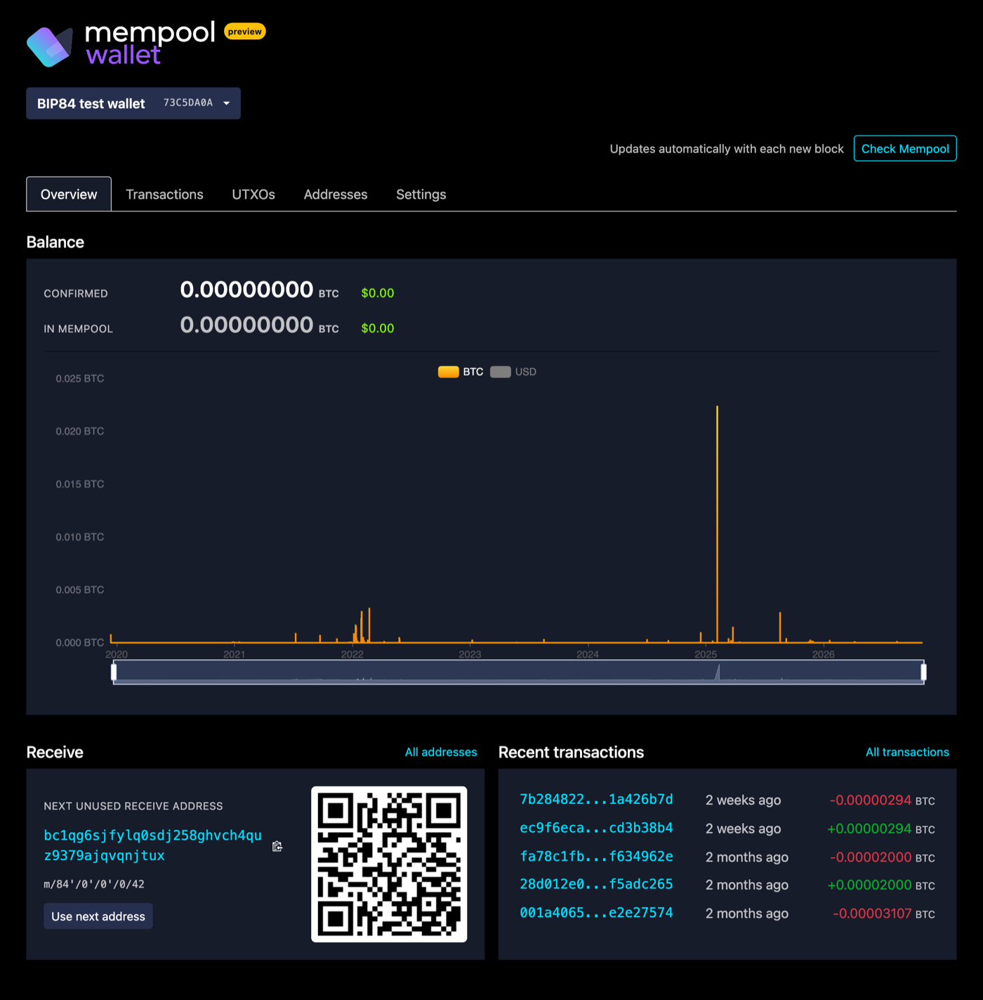
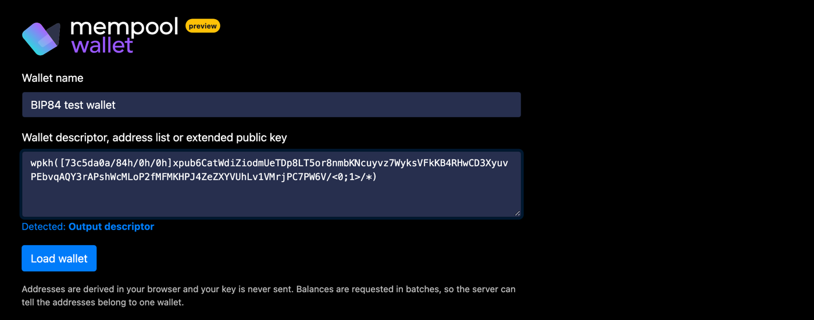
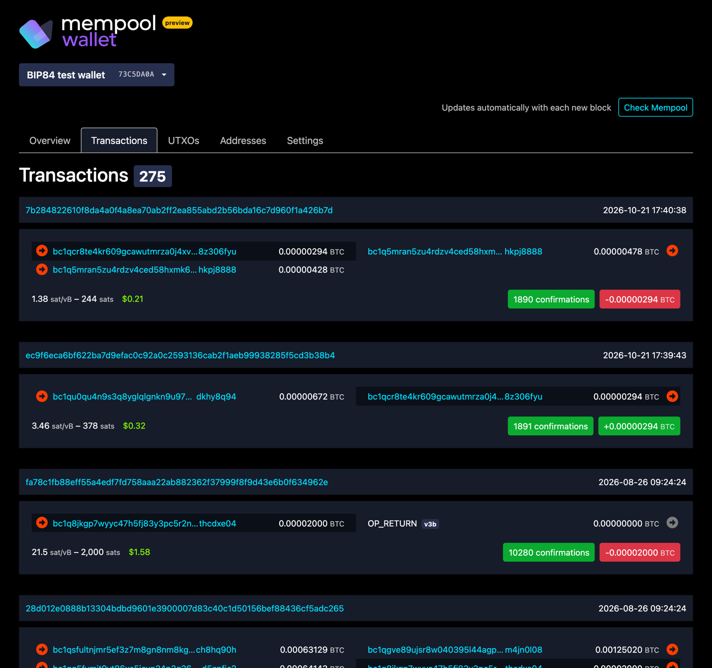
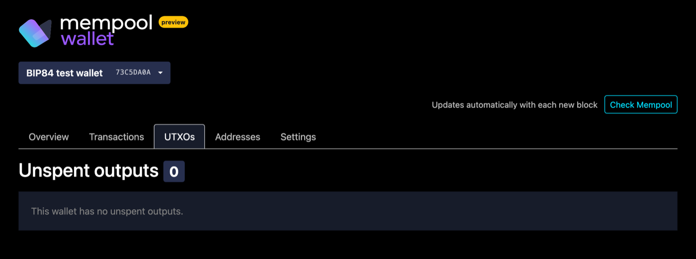
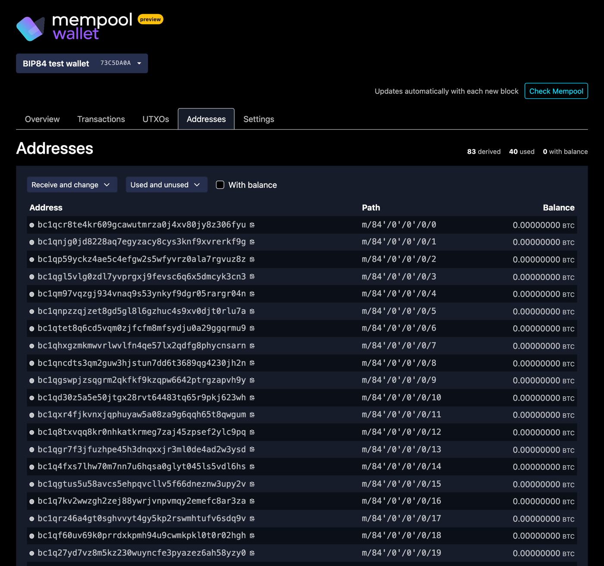
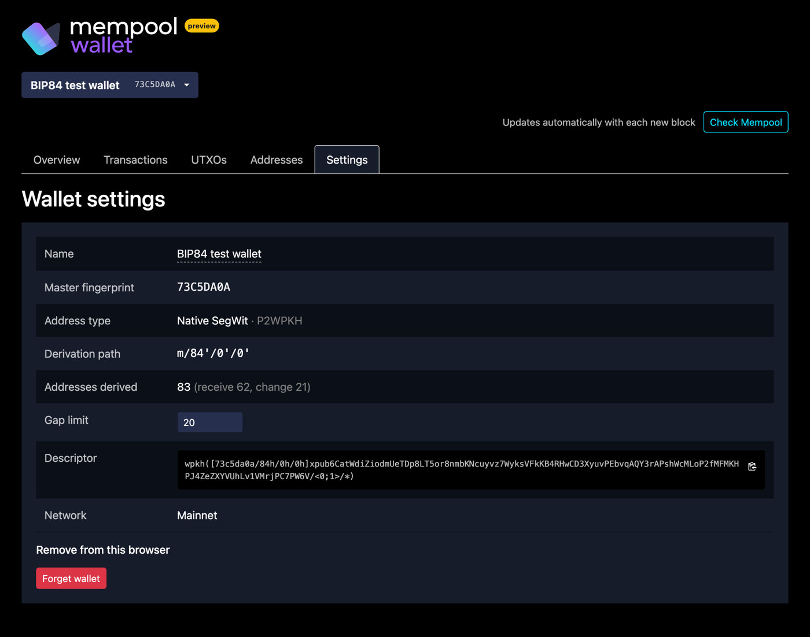
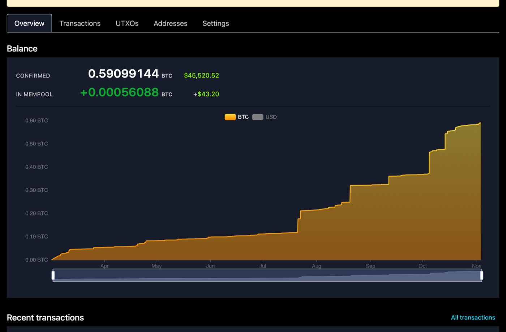

  <picture>
    <source media="(prefers-color-scheme: dark)" srcset="frontend/src/resources/mempool-wallet-logo.svg">
    
  </picture>

# mempool wallet (experimental)

> [!WARNING]
> The wallet is an experimental preview. It is not ready for production use: expect bugs, incomplete history on large wallets and changes without notice. Don't rely on it as your only view of a wallet's balance.

The mempool wallet is a **watch-only** wallet built into the mempool frontend at `/wallet`. You give it a public descriptor, an extended public key or a list of addresses, and it shows the wallet's balance, transactions, UTXOs and addresses using the same API as the rest of the site. It holds no private keys and cannot sign or send transactions.

## Enabling it

The wallet is off by default. Nothing wallet-related loads unless it is enabled.

| Setting | Default | Effect |
| --- | --- | --- |
| `WALLET_ENABLED` | `false` | Serves the wallet at `/wallet` |
| `WALLET_NAV_ENABLED` | `false` | Shows a wallet entry in the top navigation |
| `WALLET_REQUIRES_INVITE` | `false` | Limits the wallet to logged-in mempool.space accounts with the `mempool-wallet` feature |

Set them in `frontend/mempool-frontend-config.json`, or as environment variables of the same name in the Docker frontend image. Self-hosted instances should leave `WALLET_REQUIRES_INVITE` off.

The wallet runs on mainnet, testnet and signet. It is not available on testnet4, regtest or Liquid.

## Importing a wallet

The import form accepts:

- **Output descriptors:** `pkh`, `sh(wpkh)`, `wpkh` and `tr(KEY)`, plus `multi` and `sortedmulti` inside `wsh`, `sh(wsh)` or `sh`. Keys are `KEY/<0;1>/*`; a single `/0/*` or `/1/*` is widened to both chains. Checksums are verified when present.
- **Extended public keys:** `xpub`, `ypub`, `zpub` and their testnet forms. A bare `xpub` doesn't say which address type it uses, so the form asks for one.
- **Address lists:** up to 1,000 addresses, one per line.

Private keys are refused.

## What it shows

**Overview:** balance, a balance chart, the next unused receive address with a QR code, and recent transactions (shown above).

**Transactions:** the wallet's full history with the net effect of each transaction.

**UTXOs:** unspent outputs with their value and confirmation status.

**Addresses:** every derived receive and change address, with its path, use and balance.

**Settings:** name, fingerprint, address type, derivation path, gap limit (5 to 1,000, default 20), descriptor, and forgetting the wallet.

An address list works the same way, without derivation. This one watches the genesis address:

The genesis address has more history than the wallet loads in the browser, so it shows the incomplete-history warning.

## Privacy and storage

- Addresses are derived in your browser. The descriptor or key is never sent to the server.
- Address history is requested in batches. The server can therefore tell that the addresses in a batch belong to one wallet.
- Saved wallets are kept in your browser's local storage (`watch-wallets`), not on the server. Clearing site data removes them.

## Limitations

- Watch-only: no sending, signing or PSBT support.
- Wallets with more than about 10,000 transactions load incompletely and show a warning that the balance and history are incomplete.
- Unconfirmed transactions appear live only for wallets of up to 10 addresses, the server's limit per connection, and whose history loaded completely. Other wallets show them on the next block or after **Check Mempool**; a wallet with incomplete history only after **Check Mempool**.
- Taproot script paths and descriptors beyond those listed above are not supported.

The screenshots use the public BIP84 test descriptor (the `abandon … about` test mnemonic, fingerprint `73c5da0a`) and the genesis address. Don't send funds to test wallets.
